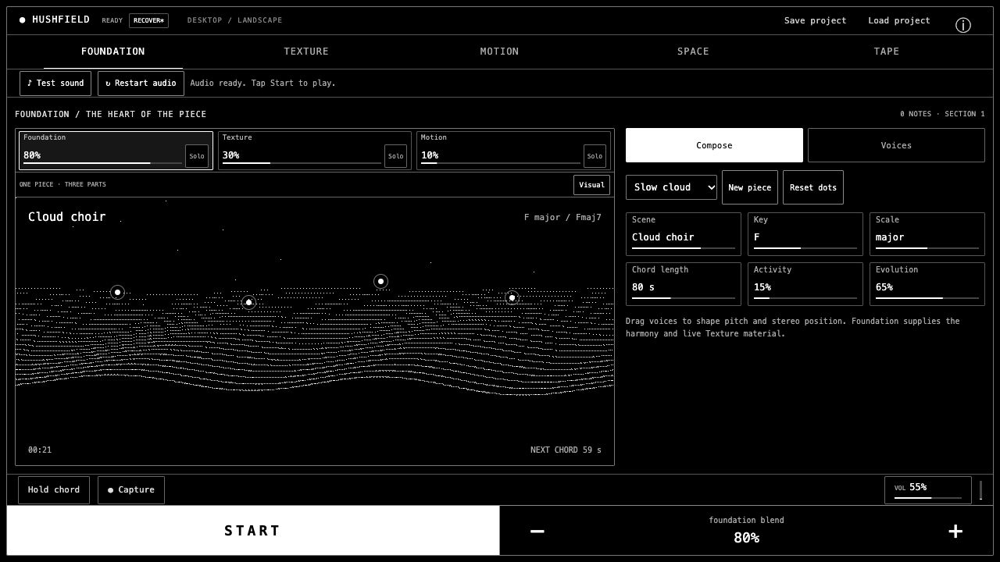
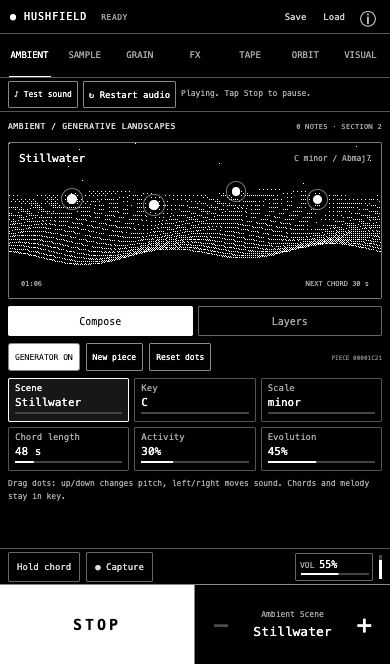
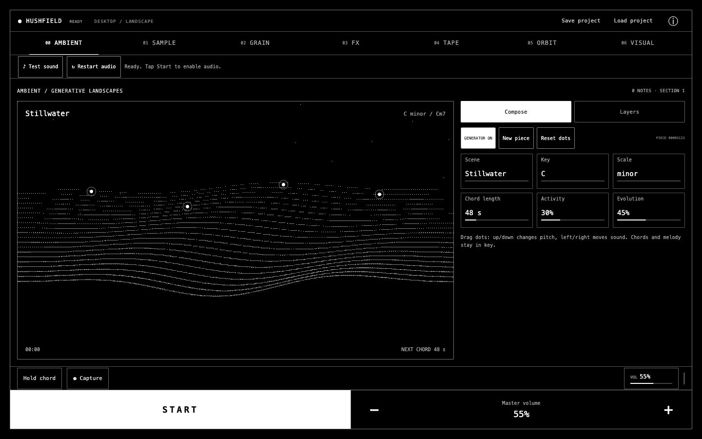

# Hushfield

[](https://github.com/jaredkirby/hushfield/actions/workflows/ci.yml)
[](LICENSE)

**Small gestures. Evolving sound.**

Hushfield is one evolving ambient piece that you shape in your browser. Start with Foundation, reshape its sound into Texture, add harmony-linked Orbit movement, and finish the complete blend with Space and Tape. The interface uses a black-and-white OLED look with ordered dithering.



## Play locally

No account, API key or backend is required. The checked-in `dist/` directory includes a ready-to-play build.

```sh
git clone https://github.com/jaredkirby/hushfield.git
cd hushfield
python3 -m http.server 4878 --bind 127.0.0.1 --directory dist
```

Open **http://127.0.0.1:4878** and tap **Start**. With Node.js installed, `npm start` runs the same preview server.

Python 3 is needed for that preview command. The app itself is static HTML, CSS and JavaScript: any suitable static server can serve `dist/`. Use **localhost or HTTPS** for AudioWorklet and microphone support; opening `index.html` directly as a file does not work.

## Shape one evolving piece

Start with **Foundation**, then add Texture and Motion. Play controls the whole piece on every page; opening another editor leaves the music and blend unchanged.

- **Foundation:** choose a complete piece or shape the ambient scene, key, scale, chord length and voices. Drag the four dots to bend pitch and stereo position. It supplies the harmonic context and recent audio for Texture even when its audible blend is zero.
- **Texture:** choose **Add texture** to reshape a rolling four-second window of Foundation audio into grains. Long grains make a smooth cloud; short grains make fragments. Density thickens the texture, Scatter distributes it, and Pitch transposes it. **Freeze phrase** keeps a portable excerpt with its original harmony; **Use live foundation** resumes evolving material.
- **Your sound / trim:** a secondary Texture editor for optional synthesized demos, imported recordings, microphone takes and trimming. Imported material retains its pitch; it is not automatically reharmonized. Listening to the original source stops the piece and plays the recording directly.
- **Motion:** **Add motion** introduces Orbit notes driven by rotating boundaries and bouncing balls. Harmony is linked to Foundation chord tones by default through an audio-thread connection. Unlink explicitly to use independent patch tuning; trigger and ball sound banks remain individually editable.
- **Space:** shared filtering, stereo width and room shape the complete normal blend.
- **Tape:** switch On for shared warmth, pitch drift and darker echoes. Drive, Wow and Flutter affect the direct sound even at zero echo Mix. Off bypasses the complete Tape effect. New sessions start with a more pronounced character; saved knob settings are retained.
- **Visual:** a display tool available from every editor, with scope, spectrum and vectorscope. Its controls affect the display only; Back to sound returns to the previous editor.

The persistent **Foundation / Texture / Motion** blend shows the audible ingredients. Select a level and use the common **− / +** adjuster. **Solo** temporarily isolates a part at an audible level while retaining its saved blend; **Full mix** restores it. Texture controls are inactive until the part is added or soloed.

Complete-piece presets set Foundation, Texture, Motion and finishing settings together. Optional source material stays available when returning to the live Foundation.

On a keyboard, **Space** starts/stops the piece and **F** holds the current chord. Focus a Foundation voice dot and use arrow keys to adjust it; **Home** resets that voice. Hold the shared adjuster buttons for repeated changes.

## Phone, iPad and desktop

The app adapts to device identity and available screen space. Portrait phones use stacked display/editor bays. iPad and desktop use a large display beside the controls; narrow Split View returns to the compact arrangement. Landscape phones and short windows use denser controls. Rotation and resizing preserve the current music and settings.

Playback and value adjustment stay in a fixed bottom rail. All seven views retain consistent bounds and fit the visible viewport without page scrolling. Browser toolbars, safe areas and pinch zoom are accounted for.

<details>
<summary>Earlier phone and desktop layout previews</summary>





</details>

## Save and record

**Save project** downloads a `.hushfield.json` file containing Texture material, the blend and source relationship, the harmony link, sound patches, Foundation settings and visual settings. **Load project** restores it; earlier version 1–3 files migrate automatically into the version 4 piece model. **Capture** downloads up to five minutes of the post-effects stereo output as a 16-bit WAV.

Session edits are kept in a bounded local recovery draft when browser storage is available. Use the session status button to recover or discard a previous draft; recovery is explicit and starts paused. LOCAL DRAFT means device-local recovery, while EXPORTED means a project download was started. Export a project file for a separate copy. Storage errors remain visible and do not block playing. Imported audio is processed locally and is not uploaded. Microphone access is requested only when you choose Record; capture stops at 60 seconds and releases the microphone tracks. There is no analytics or runtime CDN dependency.

## Audio troubleshooting

Audio needs a direct tap or click. If the instrument is silent, try **Test sound**, then **Restart audio**. Restart creates a fresh audio context while preserving the session. Also check media volume and Bluetooth/AirPlay output. Keep the page available while playing: uninterrupted background or locked-screen playback is not guaranteed.

Browser compatibility, audible output and frame rate vary by device. iPhone audio recovery has been confirmed on a physical device; the latest iPad layout has been checked through browser emulation, with physical iPad testing still welcome. The new Orbit renderer still needs physical-device listening comparison. See [verification notes](VERIFICATION.md) for the distinction between automated, emulated and device checks.

## Develop

Use **Node.js 22 or newer** and npm. Python 3 is needed only for the preview command above.

```sh
npm ci
npm run build
npm test
npm start
```

Edit sources in `dist/`, then rebuild. `ops/build.mjs` bundles the app and four AudioWorklet entry points with the pinned esbuild version; it also embeds the early viewport/navigation/startup scripts. Built files are committed so a clone can be served without a build step. Tests check input hashes and embedded scripts to catch stale builds.

`npm run test:interaction` runs a shorter interaction/startup suite. The `qa-*.html` pages in `dist/` provide browser audio and rendering diagnostics; some play a short test signal after an explicit button press. CI builds and runs all Node tests on Node 22 and 24 and verifies that generated files are current.

The [piece audio QA page](dist/qa-piece.html) checks real Worklet routing, Foundation-fed Texture, shared finishing and the direct harmony channel without live audio output.

Read the [architecture](docs/ARCHITECTURE.md), [contributing guide](CONTRIBUTING.md) and [static hosting notes](ops/README.md).

## Contribute

Bug reports, device testing, sound design improvements and pull requests are welcome. Include your browser, device, orientation and steps to reproduce when reporting a problem. See [open issues](https://github.com/jaredkirby/hushfield/issues).

## License

Hushfield is available under the [MIT License](LICENSE). Demo sources are synthesized by the app; no recorded sample library is bundled. The build dependency esbuild has its own MIT license and is installed through npm.
