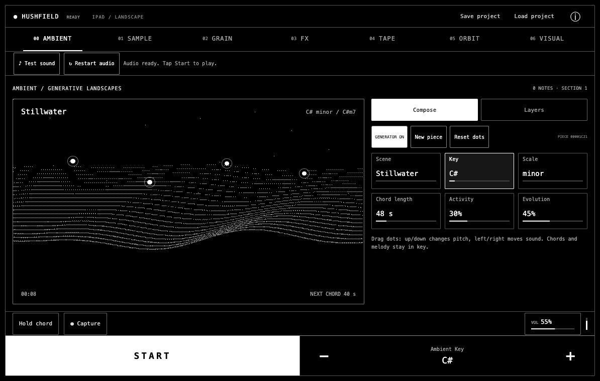

# Hushfield

[](https://github.com/jaredkirby/hushfield/actions/workflows/ci.yml)
[](LICENSE)

**Small gestures. Evolving sound.**

Hushfield is an interactive ambient music instrument that runs in your browser. Move chord voices through a soundscape, turn a sample into a cloud of grains, build rhythms with bouncing balls, and soften everything with tape echo. The interface uses a black-and-white OLED look with ordered dithering.



## Play locally

No account, API key or backend is required. The checked-in `dist/` directory includes a ready-to-play build.

```sh
git clone https://github.com/jaredkirby/hushfield.git
cd hushfield
python3 -m http.server 4878 --bind 127.0.0.1 --directory dist
```

Open **http://127.0.0.1:4878** and tap **Start**. With Node.js installed, `npm start` runs the same preview server.

Python 3 is needed for that preview command. The app itself is static HTML, CSS and JavaScript: any suitable static server can serve `dist/`. Use **localhost or HTTPS** for AudioWorklet and microphone support; opening `index.html` directly as a file does not work.

## Explore the instrument

- **Ambient:** a slow stereo chord bed, sparse melodies and air. Choose Stillwater, Night garden, Cloud choir or Glass horizon; set key, scale, activity and harmonic evolution. Drag the four dots up/down for pitch and left/right for stereo position. Automatic chord changes continue around your edits.
- **Sample:** choose a synthesized demo, import browser-decodable audio, or record the microphone. Trim up to 60 seconds of source audio and audition it before adding grains.
- **Grain:** shape grain position, size, density, pitch and spread; explore scanning, reverse, hold, elastic motion and chaos.
- **FX:** filter the sample layer and add space. Trigger and ball sound banks have their own envelopes, filters, FM, drive, pan, delay and reverb.
- **Tape:** a shared stereo echo with soft saturation, darkening repeats, continuous wow/flutter and a signal-gated noise floor.
- **Orbit:** spinning shapes and bouncing balls make rhythms. Set spin rate, shape, ball count and 1–24 trigger marks. Edit trigger and ball sounds separately, by bank or individual item.
- **Visual:** live scope, logarithmic spectrum and stereo vectorscope, with gain, trails, peak decay and a Hold view control. These controls change the display only.

Select a parameter card, then use the shared **− / +** buttons. Hold either button to repeat. On a keyboard, **Space** starts/stops and **F** holds the current chord or freezes the grain position. Focus a voice dot and use arrow keys to adjust it; **Home** resets that voice.

## Phone, iPad and desktop

The app adapts to device identity and available screen space. Portrait phones use stacked display/editor bays. iPad and desktop use a large display beside the controls; narrow Split View returns to the compact arrangement. Landscape phones and short windows use denser controls. Rotation and resizing preserve the current music and settings.

Playback and value adjustment stay in a fixed bottom rail. All seven views retain consistent bounds and fit the visible viewport without page scrolling. Browser toolbars, safe areas and pinch zoom are accounted for.

<details>
<summary>Phone and desktop previews</summary>


</details>

## Save and record

**Save project** downloads a `.hushfield.json` file containing the sample, sound patches, ambient settings and visual settings. **Load project** restores it; earlier version 1–3 files migrate automatically. **Capture** downloads up to five minutes of the post-effects stereo output as a 16-bit WAV.

Sessions live in browser memory until saved. Imported audio is processed locally and is not uploaded. Microphone access is requested only when you choose Record; capture stops at 60 seconds and releases the microphone tracks. There is no analytics or runtime CDN dependency.

## Audio troubleshooting

Audio needs a direct tap or click. If the instrument is silent, try **Test sound**, then **Restart audio**. Restart creates a fresh audio context while preserving the session. Also check media volume and Bluetooth/AirPlay output. Keep the page available while playing: uninterrupted background or locked-screen playback is not guaranteed.

Browser compatibility, audible output and frame rate vary by device. iPhone audio recovery has been confirmed on a physical device; the latest iPad layout has been checked through browser emulation, with physical iPad testing still welcome. See [verification notes](VERIFICATION.md) for the distinction between automated, emulated and device checks.

## Develop

Use **Node.js 22 or newer** and npm. Python 3 is needed only for the preview command above.

```sh
npm ci
npm run build
npm test
npm start
```

Edit sources in `dist/`, then rebuild. `ops/build.mjs` bundles the app and three AudioWorklet entry points with the pinned esbuild version; it also embeds the early viewport/navigation/startup scripts. Built files are committed so a clone can be served without a build step. Tests check input hashes and embedded scripts to catch stale builds.

`npm run test:interaction` runs a shorter interaction/startup suite. The `qa-*.html` pages in `dist/` provide browser audio and rendering diagnostics; some play a short test signal after an explicit button press. CI builds and runs all Node tests on Node 22 and 24 and verifies that generated files are current.

Read the [architecture](docs/ARCHITECTURE.md), [contributing guide](CONTRIBUTING.md) and [static hosting notes](ops/README.md).

## Contribute

Bug reports, device testing, sound design improvements and pull requests are welcome. Include your browser, device, orientation and steps to reproduce when reporting a problem. See [open issues](https://github.com/jaredkirby/hushfield/issues).

## License

Hushfield is available under the [MIT License](LICENSE). Demo sources are synthesized by the app; no recorded sample library is bundled. The build dependency esbuild has its own MIT license and is installed through npm.
