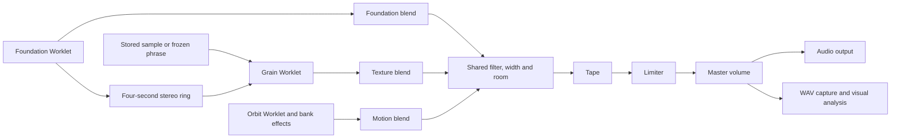

# Architecture

Hushfield is a static browser instrument with no application server, synthesis service or runtime package CDN. The [glossary](../GLOSSARY.md) defines its Piece, Foundation, Texture, Motion, Blend and Solo model.

## Startup and build

`dist/index.html` loads styles and embeds `phone-shell.js`, `page-navigation.js` and `boot.js`. Viewport sizing and navigation are available before the instrument bundle. Startup shows LOADING, READY or LOAD ERROR; unavailable editors stay inert and slow/failed startup offers Reload app. Audio readiness is separate from application readiness.

`ops/build.mjs` bundles `app.js` plus four standalone worklet files: ambient, grain, Orbit and Tape. The grain file registers both the grain and output-capture processors. Version queries on relative imports are normalized during bundling so stateful modules remain singletons. `ops/build-shell.mjs` refreshes the three embedded scripts, and `dist/build/manifest.json` records source hashes.

Sources intentionally live alongside the page in `dist/`. Generated files live in `dist/build/`. Keep the bundled main entry: it avoids a previously observed mobile startup failure in the unbundled module graph. CI verifies that rebuilding committed sources leaves shipped assets unchanged.

## Piece state and presets

`piece-session.mjs` owns blend levels, Texture source and harmony following. `piecePlayback` derives audible gains from transport and temporary Solo; it does not depend on the active editor. Foundation continues generating while the Piece plays, including when its audible blend is zero.

`piece-presets.mjs` restores a complete configuration, including finishing, patches and live/linked relationships, and cancels pending source operations. Changing Foundation's Scene is narrower; New piece changes its seed while retaining sounds and blend. `piece-blend.mjs` exposes the persistent levels and transient Solo controls through the common value adjuster.

## Normal signal path

Foundation feeds the grain processor directly before its audible fader. Live capture pauses with transport. A freeze request copies the available bounded phrase into the existing sample representation; frozen/imported material retains its original harmony/pitch. Switching back to live mode retains the optional stored sample.

Foundation and Orbit receive dedicated `MessageChannel` ports after both processors acknowledge readiness. Foundation publishes chord pitches directly; Motion quantizes new notes to current chord tones unless explicitly unlinked. Existing sustained voices finish normally. UI animation does not schedule notes.

`piece-space.mjs` sums normal parts through shared filtering, stereo width and generated convolution room before Tape. Motion's per-bank effects remain upstream. Explicit Motion auditions bypass the part fader but still enter shared finishing. Original-source preview and Test sound connect to master directly; source preview pauses the Piece.

## Audio module ownership

| Module | Responsibility |
| --- | --- |
| `app.js` | AudioContext, graph assembly, transport, settings, routing and controller integration. |
| `audio-startup.mjs` | Synchronous tap activation/priming, clock checks and context retirement. |
| `audio-lifecycle.mjs` | Processor-failure guards and graph disposal shared by failure and Restart. |
| `ambient-dsp.mjs`, `ambient-worklet.js` | Sample-clock chord voices, melody, air, voice retuning and harmony/status messages. |
| `grain-worklet.js` | Granular synthesis, bounded live Foundation material, phrase copying and output-capture processor. |
| `orbit-dsp.mjs`, `orbit-worklet.js` | Sample-clock simulation, trigger crossings, oscillator/envelope rendering and snapshots. |
| `orbit-physics.mjs`, `orbit-pads.mjs` | Fixed-step geometry, moving-boundary physics and trigger/note calculations. |
| `orbit-audio.mjs`, `sound-patches.mjs` | Twelve stereo normal/audition sends, independent bank effects, patch resolution and editing. |
| `tape-dsp.mjs`, `tape-worklet.js` | Shared direct tape path, repeats, modulation, saturation and ready acknowledgement. |

Restart creates a fresh output within a user gesture while preserving session configuration. Initial settings go through processor options and guarded readiness handling so cold-start messages are not lost. Processor failures retire the graph and surface Restart rather than leaving a healthy-looking silent transport.

## Tape

Off bypasses the complete Tape effect at the existing 0.75 dry reference gain. On crossfades over 35 ms into a short modulated direct path, nominally 8 ms, with saturation/tone plus darker echoes. Separate bounded direct/echo rings keep direct modulation out of the repeat feedback loop. Feedback is contractive and hiss is input-envelope gated.

`tape-settings.mjs` defines restrained new-session defaults without overwriting loaded settings or Worn memory's explicit stronger values. `tape-motion.mjs` shares Wow/Flutter curves with the cassette illustration. Its movement represents controls and signal level, not measured processor telemetry, and stops with bypass, pause or reduced motion.

## Interface and rendering

The five main editors are Foundation, Texture, Motion, Space and Tape. Your sound / trim and Visual are secondary tools. Stable internal IDs retain older links: `#ambient`, `#grain`, `#orbit`, `#fx`, `#tape`, `#sample` and `#visual` respectively. Source editing keeps Texture selected in the main navigation.

`phone-ui.mjs` owns selection/increments and editor panels. `phone-shell.js` distinguishes device identity from available layout space, including iPad desktop-mode identity and narrow Split View. `adaptive.css` adds wide layouts after the OLED styles. Resizing changes presentation without rebuilding audio or moving the source editor between parents.

`ambient-interaction.mjs` turns dot gestures into bounded pitch/pan edits. `ambient-points.mjs` interpolates audio output timestamps for coherent motion. The animation callback schedules display work, but `render-clock.mjs` caps expensive drawing at 30 fps and skips unchanged paused frames. Relevant edits, layout changes and audio snapshots invalidate a frame. Audio processing proceeds independently.

`oled-visuals.mjs` applies screen-stable Bayer dithering. `visual-analysis.mjs` passively captures independent stereo master channels, combining spectrum energy rather than summing waveforms that could cancel. `audio-visuals.mjs` renders Scope, Spectrum and Vector with display-only gain/trails/peaks and held-frame behavior. Trail/peak decay uses elapsed time rather than frame count. The blend/tools occupy a reserved bay so they do not cover Orbit triggers.

## Files, recording and recovery

`project-file.mjs` serializes version-4 sessions, validates versions 1–4 and migrates older namespaces/material/blend into the Piece model. Files embed WAV Texture material, Foundation voices, source/harmony relationships, patches, controls, volume and visual settings. They are configuration/material snapshots, not exact playback-position restoration; Solo is excluded. Loading is decoded and validated before application.

`sample-selection.mjs` gives each import, project, microphone take or frozen phrase ownership of its result. Newer selections invalidate older asynchronous results. Decoding can use an OfflineAudioContext without starting playback.

`microphone-take.mjs` owns pending permission, cancellation, recorder events, its 60-second timer and track cleanup. `output-capture.mjs` associates chunks/completion with a take ID and waits for finalization before accepting another take. The capture processor enforces a five-minute frame limit; `wave-file.mjs` encodes PCM chunks incrementally instead of retaining duplicate full-length float buffers.

`session-recovery.mjs` stores one draft capped at 30 MiB in IndexedDB, shared by paths on the same browser origin. Existing drafts require an explicit recover/discard choice and are not overwritten while offered. Recovery restores paused; revision guards prevent late restore results replacing newer edits. `recovery-ui.mjs` distinguishes pending edits, local storage, initiated export and errors. Quota, eviction, storage clearing and competing tabs remain browser limitations; a downloaded project is the portable copy.

## Checks and decisions

See [testing](TESTING.md) for commands, browser diagnostics and evidence semantics, and [verification](../VERIFICATION.md) for the current acceptance boundary. Specs/reviews are indexed separately under [historical work](README.md#historical-specifications-and-reviews). `docs/adr/` is the optional decision location; no ADR files are currently recorded.
