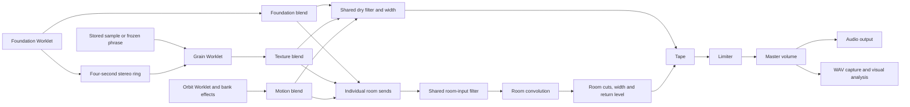

# Architecture

Hushfield is a static browser instrument with no application server, synthesis service or runtime package CDN. The [glossary](../GLOSSARY.md) defines its Piece, Foundation, Texture, Motion, Blend and Solo model.

## Startup and build

`dist/index.html` loads styles and embeds `phone-shell.js`, `page-navigation.js` and `boot.js`. Viewport sizing and navigation are available before the instrument bundle. Startup shows LOADING, READY or LOAD ERROR; unavailable editors stay inert and slow/failed startup offers Reload app. Audio readiness is separate from application readiness.

`ops/build.mjs` bundles `app.js` plus four standalone worklet files: ambient, grain, Orbit and Tape. The grain file registers both the grain and output-capture processors. Version queries on relative imports are normalized during bundling so stateful modules remain singletons. `ops/build-shell.mjs` refreshes the three embedded scripts, and `dist/build/manifest.json` records source hashes.

Sources intentionally live alongside the page in `dist/`. Generated files live in `dist/build/`. Keep the bundled main entry: it avoids a previously observed mobile startup failure in the unbundled module graph. CI verifies that rebuilding committed sources leaves shipped assets unchanged.

## Piece state and presets

`piece-session.mjs` owns blend levels, Texture source and harmony following. `piecePlayback` derives audible gains from transport, bounded phrase factors and temporary Solo; it does not depend on the active editor. Foundation continues generating while the Piece plays, including when its audible blend is zero. Phrase factors multiply only normal audible levels; Solo bypasses those factors without editing Blend.

`piece-presets.mjs` restores a complete configuration, including finishing, patches and live/linked relationships, and cancels pending source operations. Changing Foundation's Scene is narrower; New piece changes its seed while retaining sounds and blend. `piece-blend.mjs` exposes the persistent levels and transient Solo controls through the common value adjuster.

## Normal signal path

Foundation feeds the grain processor directly before its audible fader. Live capture pauses with transport. A freeze request copies the available bounded phrase into the existing sample representation; frozen/imported material retains its original harmony/pitch. Switching back to live mode retains the optional stored sample.

Foundation and Orbit receive dedicated `MessageChannel` ports after both processors acknowledge readiness. A separate readiness-gated channel connects Foundation to Texture. Foundation publishes chord pitches and phrase factors directly at chord changes and at 10 Hz on the audio clock; Texture slews a density multiplier and Motion gates automatic events deterministically while physics and explicit auditions continue. Main-thread status updates smoothly adjust normal part gains, while event/grain timing remains independent of drawing. Classic pieces publish unity factors. Motion quantizes new notes to current chord tones unless explicitly unlinked. Existing sustained voices finish normally. UI animation does not schedule notes.

`piece-space.mjs` provides named part inputs and sums normal dry parts through shared filtering and width before Tape. Modern per-part room sends receive the same tone, feed the generated convolution impulse, then pass through low/high cuts and room width. A versioned classic route retains the original shared room send and return. `space-settings.mjs` owns validated depth defaults. The diagram shows modern routing; classic routing takes its room send from the shared dry filter/width output and bypasses modern return cuts/width processing. Motion's per-bank effects remain upstream. Explicit Motion auditions bypass the part fader but still enter shared finishing. Original-source preview and Test sound connect to master directly; source preview pauses the Piece.

## Audio module ownership

| Module | Responsibility |
| --- | --- |
| `app.js` | AudioContext, graph assembly, transport, settings, routing and controller integration. |
| `audio-startup.mjs` | Synchronous tap activation/priming, clock checks and context retirement. |
| `audio-lifecycle.mjs` | Processor-failure guards and graph disposal shared by failure and Restart. |
| `ambient-dsp.mjs`, `ambient-worklet.js` | Sample-clock chord voices, melody, air, voice retuning and harmony/status messages. |
| `grain-worklet.js` | Granular synthesis, bounded live Foundation material, phrase copying and output-capture processor. |
| `orbit-dsp.mjs`, `orbit-worklet.js` | Sample-clock simulation, trigger crossings, oscillator/envelope rendering and snapshots. |
| `orbit-physics.mjs`, `orbit-pads.mjs` | Fixed-step geometry, moving-boundary physics and trigger/note calculations. |
| `orbit-audio.mjs`, `sound-patches.mjs` | Twelve stereo normal/audition sends, independent bank effects, patch resolution and editing. |
| `tape-dsp.mjs`, `tape-worklet.js` | Classic Tape, model transitions, shared processing and ready acknowledgement. |
| `space-echo-dsp.mjs` | Mono three-head tape transport, speed history, filtered feedback, stereo preamp and parallel synthetic spring. |

Restart creates a fresh output within a user gesture while preserving session configuration. Initial settings go through processor options and guarded readiness handling so cold-start messages are not lost. Processor failures retire the graph and surface Restart rather than leaving a healthy-looking silent transport.

## Tape

Off bypasses both models at the existing 0.75 dry reference gain. Classic preserves the earlier algorithm, including the nominal 8 ms modulated direct path, saturation, tone and single stereo echo. Separate bounded direct/echo rings keep direct modulation out of its repeat feedback loop. Its feedback remains contractive.

Space Echo records a mono sum after stereo preamp saturation. Three fixed head offsets read one audio ring through stored cumulative tape-distance coordinates. This preserves the tape-speed history behind temporary pitch changes, rather than treating time changes as moving the heads. Head times have ideal 1:2:3 spacing, with Head 3 time from 0.05 to 1.5 seconds. A 120 ms motor time constant smooths speed changes; shared deterministic Wow and Flutter vary transport speed. High-pass and two low-pass stages filter each return, with the low-pass cutoff following Tone and speed. Averaged selected returns feed back through saturation; wet output uses square-root head-count compensation. These are tuned gain/filter choices rather than a calibrated RE-201 circuit.

Drive also saturates each stereo direct channel. The direct path has no tape delay, Wow, Flutter or Tone filtering in this model. Three independent damped delay paths with all-pass dispersion produce a synthetic spring, fed in parallel from the preamp sum. The paths are not mechanically coupled. The original twelve-mode head/spring selection gates its return; spring and echo have independent levels. High Feedback can sustain bounded oscillation after excitation. Lowering Feedback or leaving Tape Off drains the loop. Hiss is input-envelope gated in both models.

`tape-dsp.mjs` keeps both machines running during a model transition with 35 ms exponential smoothing. Switching from a settled model starts the destination with empty history. Reversing a transition retains both contributing machines to avoid a waveform discontinuity. After the transition settles, only the selected model processes audio. Settings, On/Off and head selection also use smoothing. See [RE-201 research and approximations](research/re201-space-echo.md) for source references and fidelity limits.

`tape-settings.mjs` separates existing numeric defaults from explicit fresh-session Space Echo settings. New Pieces select model 2, Head mode 4 and Spring level 12%, with Tape Off. Mode 4 has no spring return. Saved settings missing a valid explicit model select Classic regardless of schema version; export records the selected model. Worn memory explicitly retains Classic. Head mode and spring level survive save and recovery even while Tape is Off. `tape-motion.mjs` supplies the cassette illustration's Wow/Flutter curves. Its movement represents settings and signal level, not measured processor telemetry, and stops with bypass, pause or reduced motion.

`tape-presets.mjs` defines five complete Tape sound configurations. Applying one copies only its sound fields and preserves `tapeOn`. The native command menu wraps the change in one settings-history entry. Its displayed name is derived by exact comparison with the current numeric fields, so no preset ID can become stale in a saved project or recovery draft. Manual edits and Classic settings show Custom settings.

## Interface and rendering

The five main editors are Foundation, Texture, Motion, Space and Tape. Your sound / trim and Visual are secondary tools. Stable internal IDs retain older links: `#ambient`, `#grain`, `#orbit`, `#fx`, `#tape`, `#sample` and `#visual` respectively. Source editing keeps Texture selected in the main navigation.

`phone-ui.mjs` owns direct sliders, exact-entry dialogs, selection/increments and editor panels. `visual-editors.mjs` and `visual-editor-math.mjs` map visual gestures and keyboard edits to the same parameter setters as the precise controls. `sound-editor.mjs` and its model handle individual/All targets and mixed values; selecting a target does not audition it. `motion-controls.mjs` supplies Motion's additional direct controls.

`control-history.mjs` stores up to 40 settings snapshots. Nested edit-start/end events group one continuous gesture into one Undo entry; cancellation restores its start. Application integration owns restore/synchronization and clears history when material, project, complete preset, recovery or New piece replaces the edit context. History excludes buffers, recordings and transport, and is not serialized as project or recovery history. The fixed square display and scrolling inspector keep the separate Start/Stop transport outside the edit surface.

`phone-shell.js` distinguishes device identity from available layout space, including iPad desktop-mode identity and narrow Split View. `adaptive.css` adds wide layouts after the OLED styles. Resizing changes presentation without rebuilding audio or moving the source editor between parents.

`ambient-interaction.mjs` turns dot gestures into bounded pitch/pan edits. `ambient-points.mjs` interpolates audio output timestamps for coherent motion. The animation callback schedules display work, but `render-clock.mjs` caps expensive drawing at 30 fps and skips unchanged paused frames. Relevant edits, layout changes and audio snapshots invalidate a frame. Audio processing proceeds independently.

`oled-visuals.mjs` applies screen-stable Bayer dithering. `visual-analysis.mjs` passively captures independent stereo master channels, combining spectrum energy rather than summing waveforms that could cancel. `audio-visuals.mjs` renders Scope, Spectrum and Vector with display-only gain/trails/peaks and held-frame behavior. Trail/peak decay uses elapsed time rather than frame count. Texture reuses the Scope renderer for its stereo material overview, while `texture-wave.mjs` and `texture-adjustments.mjs` provide display-only waveform smoothing and shared adjustment controls. Grain status includes both stereo waveform channels and phrase density. The blend/tools occupy a reserved bay so they do not cover Orbit triggers.

## Files, recording and recovery

`project-file.mjs` serializes version-5 sessions, validates versions 1–5 and migrates older namespaces/material/blend into the Piece model. Files embed WAV Texture material, Foundation voices, source/harmony relationships, patches, controls, volume and visual settings. They are configuration/material snapshots, not exact playback-position restoration; Solo is excluded. Loading is decoded and validated before application. Versions 1–4 force classic Foundation and room routing; explicit version-5 sound/depth modes survive re-export. Fresh defaults and complete presets use expressive Foundation version 2; saved settings objects missing that field remain classic. Editing Foundation Sound promotes Foundation synthesis independently; editing any Depth control opts the Piece into modern room routing for all three sends. Tape's model is independent of these modes and defaults to Classic for saved files lacking an explicit selection. See [the compatibility decision](adr/0001-preserve-saved-sound-models.md).

`sample-selection.mjs` gives each import, project, microphone take, native-library selection or frozen phrase ownership of its result. Native source assets are same-origin WAVs fetched only on selection; metadata identifies their fixed original pitch. Newer selections invalidate older asynchronous results. Decoding can use an OfflineAudioContext without starting playback.

`microphone-take.mjs` owns pending permission, cancellation, recorder events, its 60-second timer and track cleanup. `output-capture.mjs` associates chunks/completion with a take ID and waits for finalization before accepting another take. The capture processor enforces a five-minute frame limit; `wave-file.mjs` encodes PCM chunks incrementally instead of retaining duplicate full-length float buffers.

`session-recovery.mjs` stores one draft capped at 30 MiB in IndexedDB, shared by paths on the same browser origin. Existing drafts require an explicit recover/discard choice and are not overwritten while offered. Recovery restores paused; revision guards prevent late restore results replacing newer edits. `recovery-ui.mjs` distinguishes pending edits, local storage, initiated export and errors. Quota, eviction, storage clearing and competing tabs remain browser limitations; a downloaded project is the portable copy.

## Checks and decisions

See [testing](TESTING.md) for commands, browser diagnostics and evidence semantics, and [verification](../VERIFICATION.md) for the current acceptance boundary. Specs/reviews are indexed separately under [historical work](README.md#specifications-and-evidence). `docs/adr/` records non-obvious compatibility decisions. Native authoring and deterministic listening fixtures are development tools, separate from the static application; see [the workflow](SURGE-TEXTURE.md).
