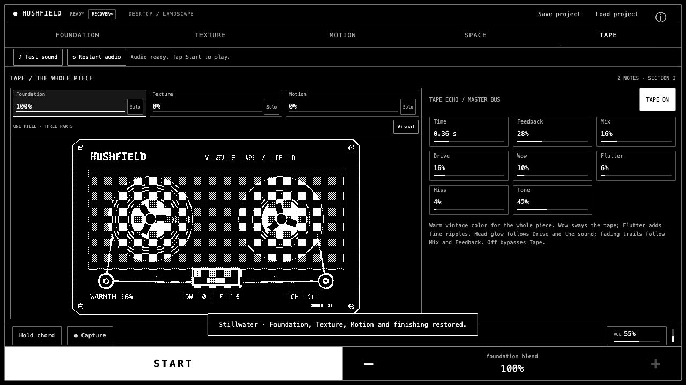

# Playing Hushfield

Hushfield makes one Piece from three sound parts: Foundation, Texture and Motion. Space and Tape finish their blend. The [glossary](../GLOSSARY.md) defines these terms.

## Start and blend

Tap Start to play the complete Piece. Opening another editor changes the controls and display, not the music. Select a value card and use the common minus/plus pair. A zero blend level means that part is inaudible; Add texture sets Texture to 35%, and Add motion sets Motion to 25%. These actions set the level; they do not start a stopped Piece.

Solo makes one part audible even if its saved blend level is zero, while temporarily silencing the other parts. Full mix restores their saved levels. Solo is not written to project files or recovery drafts.

## Foundation

Compose controls the scene, key, scale, chord length, activity and evolution. Voices adjusts the chord bed, melodic notes and airy noise. The four dots are sustained chord voices: drag vertically for scale steps and horizontally for pan. The pitches glide to their new values. Reset dots returns all four to their default positions.

Hold chord pauses harmonic changes while the Piece continues. New piece changes the seed and restarts its musical progression while keeping sounds and blend settings.

The complete-piece menu is different from Scene. Stillwater, Slow cloud, Glass shards and Worn memory set Foundation, blend levels, live Texture source, linked Motion, sound patches and finishing controls together. The Scene card changes Foundation's scene without replacing the whole Piece. Existing optional source material remains available in Your sound / trim.

## Texture sources

The source status distinguishes three kinds of material:

| Status | Material and pitch behavior |
| --- | --- |
| LIVE · RECENT FOUNDATION | A rolling four-second stereo window generated while the Piece plays. It continues to receive Foundation audio even when Foundation's audible blend level is zero. |
| FROZEN PHRASE · ORIGINAL HARMONY | A fixed excerpt copied from that window. It retains the harmony present at capture. |
| YOUR SOUND · ORIGINAL PITCH | An optional demo, imported recording or microphone take. It is not automatically reharmonized. |

Start the Piece and let it play briefly before choosing Freeze phrase. During the first four seconds, the available phrase may be shorter; at least a quarter-second of material is required. Use live foundation switches back to evolving material without discarding the stored optional source.

Grain size and density shape smoothness and thickness. Position chooses material; Scatter spreads grain positions; Pitch transposes them. Scan direction, range, speed, wander and smoothing move through the material, while Motion controls add static/hold/jump/reverse/elastic/chaotic behavior. Texture's synthesis controls are inactive until it is added or soloed.

Your sound / trim opens the source tool. Import browser-decodable audio, choose a synthesized demo, or record the microphone. The app retains up to 60 seconds of source audio. Apply trim commits the selected range; Restore full sample returns to the retained original. Returning with Use this material selects it as Texture; opening an editor alone does not raise its blend level.

Listen to source pauses the Piece and plays the original material directly through master volume, bypassing shared Space and Tape. It is an audition, not a preview of the processed Texture.

## Motion and harmony

Motion uses Orbit: a rotating circle/polygon, bouncing balls and 1–24 equally spaced trigger marks. Spin rate controls the rhythm; Reverse spin changes its direction. Stop spin sets zero RPM, halting new automatic notes while existing sound tails can decay. Scatter resets the balls.

HARMONY LINKED makes new notes follow Foundation's current chord tones. Foundation continues supplying harmony at zero audible Foundation blend. INDEPENDENT NOTES uses patch tuning instead. Existing sustained notes finish normally when harmony changes. Imported and frozen Texture material is not retuned by this link.

Triggers and Balls have separate sound banks. Select All or an individual item, then edit Voice, Envelope, Tone or Space. An All edit changes that field across the bank while retaining unrelated overrides. Bank delay/feedback/room controls apply to that bank. Listen and tapping a trigger audition its patch through shared finishing without raising the Motion blend level.

## Shared finishing

Space's filter, stereo width and room process the normal Foundation, Texture and Motion blend. Motion's own bank effects remain upstream of this shared path.

Tape starts Off in a new session. On adds a warm direct tape path and darker repeats. Drive, Wow, Flutter and Tone affect the direct signal even at zero echo Mix. Mix sets repeat level; Time sets delay length; Feedback controls repeats; Hiss follows the input envelope. Off bypasses the whole Tape effect, including repeats and coloration.

The new-session settings are Time 0.36 s, Feedback 28%, Mix 16%, Drive 16%, Wow 10%, Flutter 6%, Hiss 4% and Tone 42%. Loaded project settings are retained, and Worn memory deliberately uses a stronger character.

The cassette illustrates the settings and signal level: Wow sways the path, Flutter adds ripples, Drive brightens the head and Mix/Feedback shape fading repeats. This is an illustration, not measured tape telemetry. Movement settles in bypass, freezes while stopped and respects reduced motion.

## Visual and keyboard controls

Visual opens Scope, Spectrum or Vector from any editor. Scope shows left/right waveforms; Spectrum shows logarithmic frequency bands; Vector shows the stereo phase image and correlation. Display gain, trails, smoothing, range and peak decay do not change the sound. Hold view freezes the picture while the Piece continues. Back to sound returns to the previous editor.

| Key | Action |
| --- | --- |
| Space | Start/stop the Piece when focus is outside a button, link, input or select. |
| F | Hold/release the current chord under the same focus rule. |
| Left / Right on a parameter | Decrease/increase the selected value. |
| Arrows on a voice dot | Adjust pitch or stereo position. |
| Home on a voice dot | Reset that voice. |

Expensive drawing is capped at 30 fps independently of audio processing. Audio timestamps keep voice movement aligned with the Piece; paused views redraw when relevant state changes.

## Save, recover and record

Save project downloads a version-4 `.hushfield.json` file. It contains the retained sample/frozen phrase, Texture source relationship, blend, harmony link, Foundation voices, patches, controls, volume and Visual settings. Versions 1–3 load through migration; their retained material/blend are preserved and Motion uses independent tuning. The file restores configuration and material, not an exact playback position, waveform history or Solo state. Project input is limited to 30 MiB, including encoded audio.

Recovery stores one bounded draft per browser origin (scheme, host and port) in IndexedDB. Paths on the same origin share this draft. A previous draft is offered explicitly; edits do not overwrite it until you recover or discard it. Recovery replaces the current session and starts paused. Private browsing, storage clearing/quota, multiple tabs or eviction can affect availability; export a project for a separate copy.

| Session status | Meaning |
| --- | --- |
| UNSAVED / SAVING | Edits are waiting for, or writing, a local draft. |
| LOCAL DRAFT | The latest draft was stored on this device. |
| RECOVER | A previous draft is available; open the status dialog to choose. |
| RECOVERED | The draft was restored with playback paused. |
| EXPORTED | A project download was initiated; the browser handles saving it. |
| SAVE ERROR | Draft storage failed; export a file and use Save local draft to retry. |

An asterisk indicates changes since the last project export. RECOVERING, DISCARDING and NO DRAFT describe the corresponding dialog operations.

To record a performance, Start the Piece, choose Capture, then Finish capture. The app exports post-effects/master-volume stereo PCM as a 16-bit WAV, up to five minutes. Finalization completes before another take can begin. Capture does not start a stopped Piece.

Record microphone requests permission and pauses the Piece once recording begins. Cancel microphone request cancels a pending take; Stop recording ends an active take. Takes stop at 60 seconds and release their microphone tracks. The recording becomes optional Texture material for trimming. Finish recording/capture before Restart audio.

All audio processing, imported recordings and recovery drafts stay in the browser. See [verification limits](../VERIFICATION.md) for what has been checked on physical devices.
