# UI development history

Historical observations from the visual-control branch on 2026-10-25, retained in
reverse chronological order. These describe the checked revision at each step;
counts and screenshots are not current acceptance evidence.

[PR #22](https://github.com/jaredkirby/hushfield/pull/22) merged the final UI with
musical expression at `17794182f53d3175f88230200d83a734a58051e6`.
The final UI uses the separate bottom Start/Stop button, black visual in both
playback states, no paused overlay and no transport waveform. The full-height
square and scrolling inspector supersede earlier square measurements. Texture
uses the shared stereo Scope renderer, its adjustments open by default, and
Wave smoothing defaults to 65%. Earlier artwork, defaults and playback-overlay
experiments below are superseded. See [Playing](PLAYING.md) for current controls
and [Verification](../VERIFICATION.md) for combined evidence and acceptance limits.

## Original Start/Stop restored — 2026-10-25

Restored the separate Start/Stop button beside minus/plus in the bottom control bar. Removed whole-square playback activation and all paused inversion/gradient overlays; the visual stays black in both playback states. Restored immediate background editing and Orbit tap-to-nudge behavior. The square sizing and scrollable adjustments remain intact, and the bottom output waveform remains hidden.

The build, full 73-result Node suite, targeted geometry/startup checks and whitespace checks passed. Browser checks confirmed a visualization tap leaves playback paused, Start begins playback, Stop pauses, and the button lives in the transport bar with no overlay or visual filter.

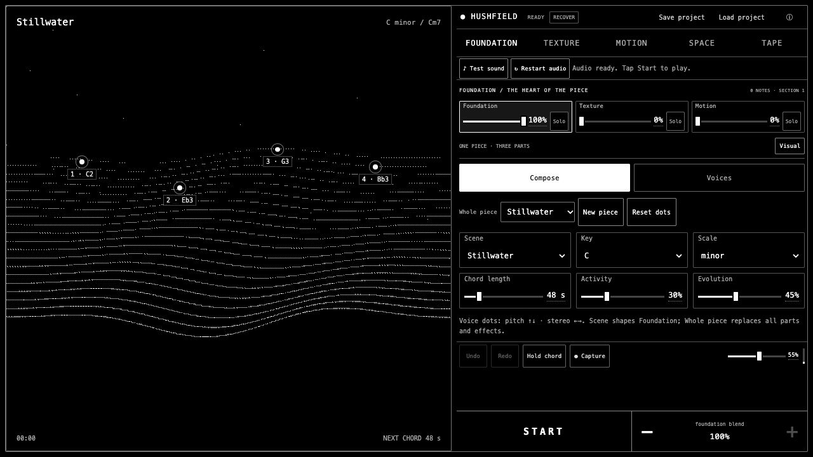

## Dithered paused circle — 2026-10-25

The paused circular fade now uses the same black/white 4×4 Bayer dithering as the app's visual renderer. A static canvas is regenerated only when the square changes size, preserving crisp pixels instead of a smooth gray CSS gradient. It ignores pointer events and disappears while playing. The build, six targeted geometry/startup/transport checks and whitespace checks passed. Browser checks confirmed tap-to-play hides the dither, tap-to-pause restores it, and the portrait canvas resizes to 372×372 inside the 374 px square.

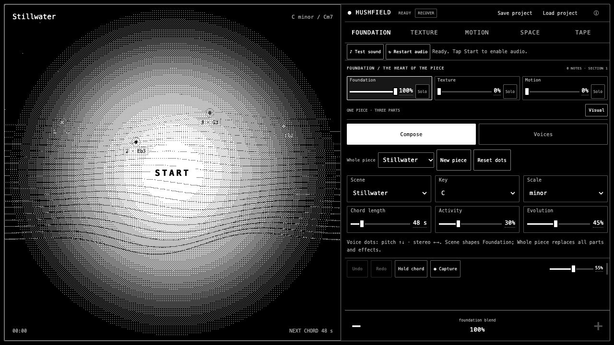

## Circular paused gradient — 2026-10-25

Paused playback now uses a circular white-center-to-black-edge gradient in place of the uniform inverse. A contained difference-blend overlay preserves the dithered visualization, labels and gesture targets beneath it; the overlay ignores pointer events and is absent while playing. The build, startup and transport regression checks passed. Browser checks confirmed the paused gradient, normal black playback, tap-to-pause restoration and circular scaling at 390×844 without overflow.

## Visualization as playback control — 2026-10-25

The native Start/Stop button now fills the fixed square visual stage. A stationary background tap invokes the existing audio transport, with keyboard Enter/Space and screen-reader activation retained. The whole square inverts to white while paused and returns to black while playing. The control footer now contains only the selected value and minus/plus. The output waveform remains disabled.

Visual handles and fields remain independent. Background edits wait for movement beyond 6 px, so a tap does not change Texture position, filter/echo settings or spectrum inspection. Orbit background nudges also require a drag. Pointer cancellation, lost capture, secondary touches and disabled transport are covered by transport regression tests.

The build and full 76-result Node suite passed; final targeted transport and startup checks passed after the last code changes. Browser checks verified native button bounds inside the square, background tap and keyboard toggles, Foundation voice dragging without stopping, Texture tap without parameter changes, Texture dragging and grain-length adjustment while playing, and spectrum tap/drag separation. At 390×844, the square stayed 374×374 with no outer overflow and switched between white paused and black playing states. These are desktop-emulated checks; physical touch acceptance remains with the user.

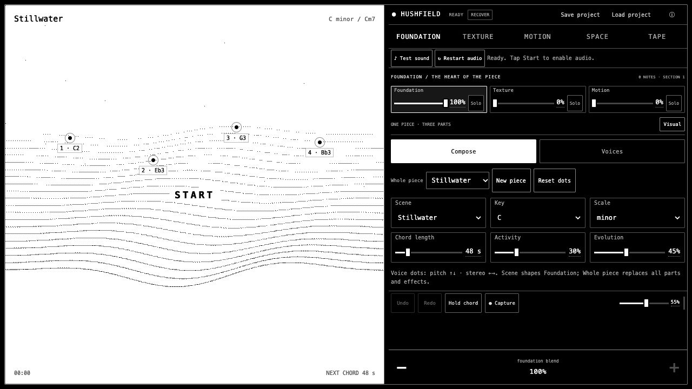

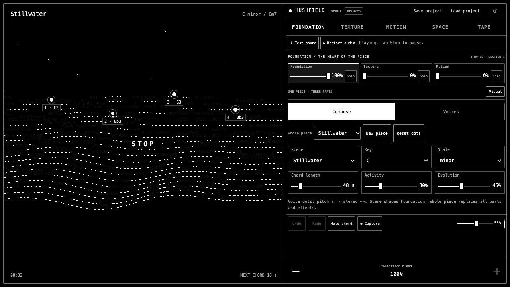

## Dynamic browser-height follow-up — 2026-10-25

The viewport shell now measures CSS `100dvh` as well as `visualViewport.height` and observes dynamic-height changes. This addresses the suspected stale-height condition behind the unused bottom strip in the supplied iPad screenshot. Text entry still uses the smaller visible height when a substantial keyboard/picker obstruction is detected; focused sliders and ordinary menu focus do not reintroduce the chrome-sized gap. Unsupported `dvh` falls back to the existing visual viewport behavior. Pinch zoom retains the existing sizing guard.

The build and full 73-result Node suite passed, followed by targeted viewport and inline-startup checks after the final focus handling update. New regression assertions cover a stale 638 px visual viewport with 744 px dynamic height, dynamic-height observation without a visual-viewport event, keyboard avoidance/dismissal, menu/range focus and legacy fallback.

Browser checks at 1280×638, 1280×744 and 390×844 matched the app height to the viewport, with square sizes 620, 726 and 374 px respectively. The instrument ended 8 px above the bottom at each size, with no outer overflow or console warnings/errors. These are desktop-emulated and simulated-mismatch checks; the specific physical iPad browser condition is inferred from the photo and still needs user confirmation after refreshing.

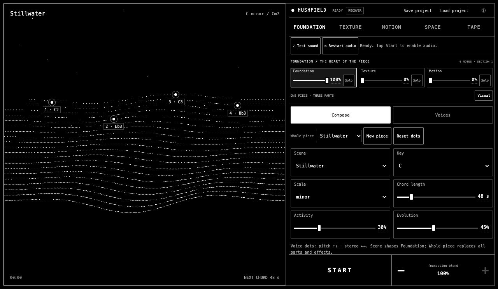

## Visual-first square sizing — 2026-10-25

The shared square now takes the available screen height in landscape or width in portrait, with an 8 px outer margin. Header, tabs, audio checks, blend and adjustments move into a separately scrolling control area beside/below it. Tabs stay pinned in that area, with Start/Stop and minus/plus in a fixed bottom row. Narrow controls use fewer columns and wrapping, preserving a minimum reachable control area in nearly square windows.

The build and all 73 Node results passed; final targeted geometry, startup consistency and phone-control checks also passed. Browser measurements: 1280×720 gives a 702 px square; 390×844 gives 374 px; 320×568 gives 304 px; 844×390 gives 374 px; both 768×1024 and 1024×768 give 750 px. Outer document dimensions matched each viewport. At 390×844, scrolling controls left the square fixed at x=8, y=8, 374×374. All five editor pages were checked in the narrow 248 px landscape control column; a Texture tab overflow found there was corrected.

The corrected narrow Texture controls measured 248 px content/viewport width with no overflow. Minus/plus and Start/Stop remained interactive, and no console warning/error was observed. The output waveform remains disabled.

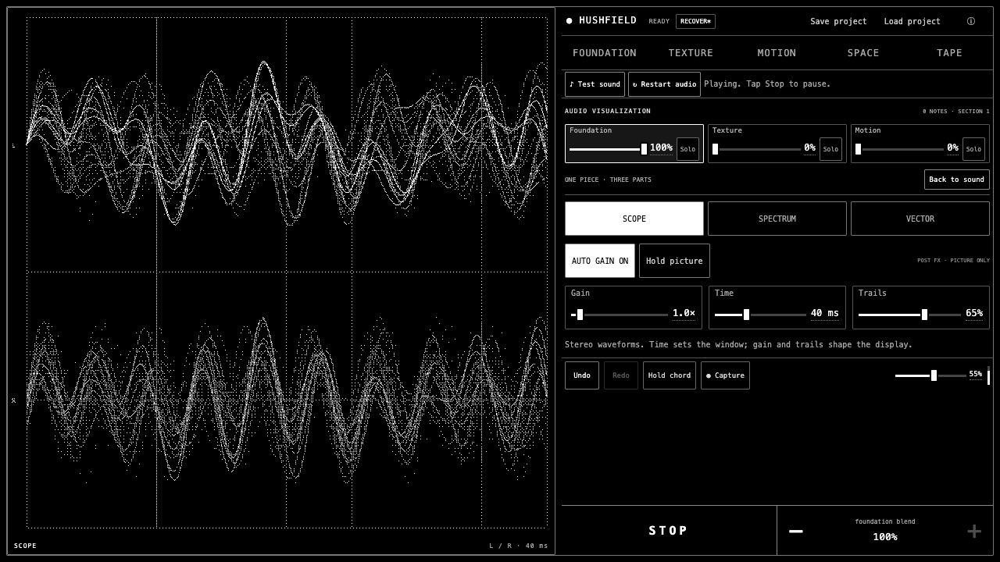

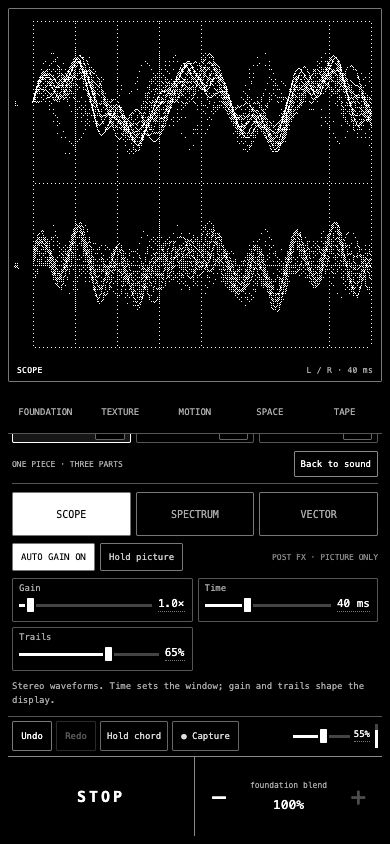

## Fixed square viewport — 2026-10-25

The shared visual stage is square across all editors and Visual. Blend, toolbar and editor controls live in a separate adjustment dock, beside the square in landscape and below it in portrait. Its independent scrolling and Texture visibility toggle do not change the square's geometry. Only available viewport size/orientation affects square sizing; the layout reserves reachable adjustment space even in short windows.

The build, all 73 Node results and whitespace checks passed. New geometry tests cover portrait/landscape room for settings, compact viewports and collapsed bays. Browser checks covered 1280×720, 390×844, 320×568, 844×390, 768×1024 and 1024×768. Stage dimensions were respectively 432, 374, 207, 180, 466 and 400 px square, with no outer-document overflow. Foundation, Texture, Motion, Space, Tape and Visual retained the same stage bounds at 390×844. Foundation, Texture, Motion and Visual canvases fill the square; Tape keeps its existing cassette/echo subdivision within the square stage.

At 390×844, scrolling the dock and hiding Texture fields left the stage unchanged at x=8, y=143, 374×374. The landscape Texture canvas measured 430×430 inside its 432×432 border. These are emulated-browser checks; physical-device touch/performance acceptance remains with the user.

No console warnings/errors were observed in the checked session. The bottom output waveform remains disabled.

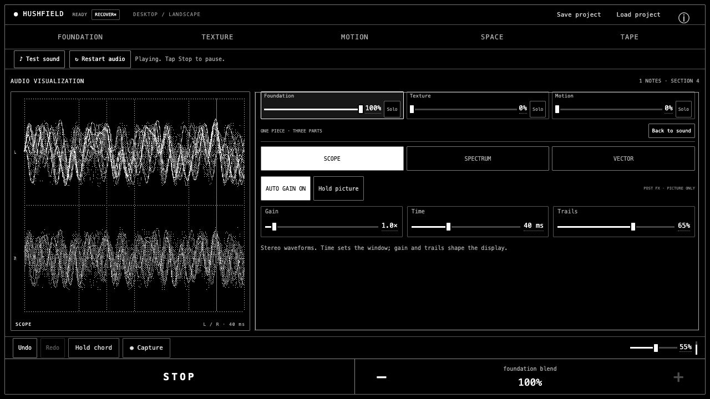

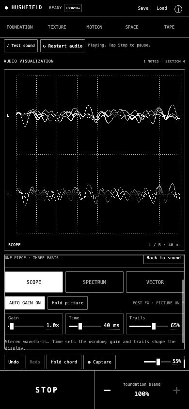

## Bottom waveform disabled — 2026-10-25

The bottom-bar output waveform is hidden. Its zero-size canvas is skipped by the frame loop, so it no longer draws while playback continues. The build, startup consistency and whitespace checks passed.

## Full-width bottom waveform — 2026-10-25

The main-output Scope canvas now spans the entire bottom bar behind Start/Stop and the shared minus/plus controls. The controls retain separate pointer targets, with small black label backings over the continuous picture. The source window expands proportionally to the doubled canvas width to preserve the previous horizontal wave scale. The build and all 71 Node results passed.

Browser checks covered desktop and 390×844 phone playback. The canvas filled the 1262 px desktop bar and the 390 px phone bar, ignored pointer events, and introduced no phone overflow. Decrease and Increase changed the selected Foundation blend from 100 to 95 and back to 100; Start/Stop still worked. No console warnings/errors were observed.

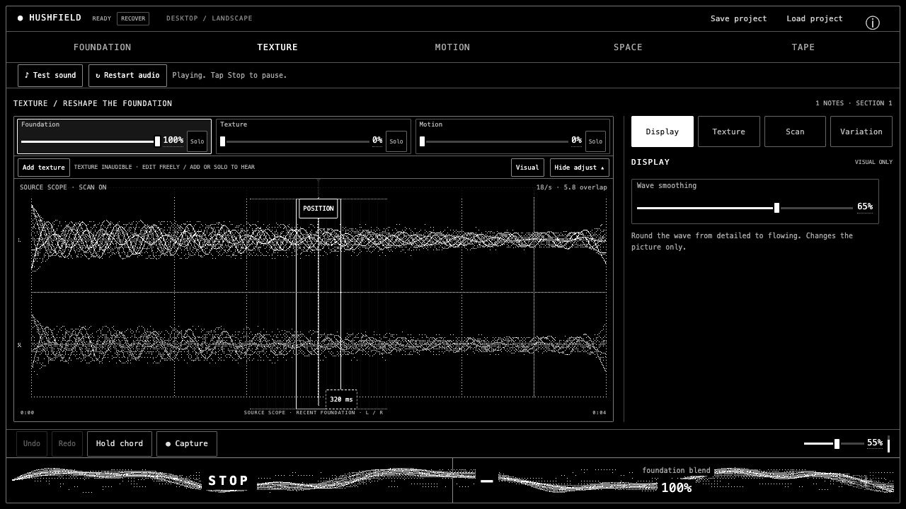

## Wider output waveform — 2026-10-25

The button now shows a 20 ms window instead of 40 ms, stretching waveform features horizontally by 2× while retaining dither falloff and silence clearing. The build, output Scope regression checks, startup consistency checks and whitespace check passed.

## Dither falloff restored — 2026-10-25

The single button waveform again uses Scope's dithered fading trails while retaining no grid or channel labels and clearing completely at silence. Reduced motion disables trails. The build, output Scope regression checks, startup consistency checks and whitespace check passed. The silence regression now runs with fading trails enabled and confirms stored traces are cleared.

## Single output waveform — 2026-10-25

The button output display now draws one trace without a grid, channel labels or trails. Silent output (RMS at or below 0.0001) clears the canvas and stored trail, leaving just the button label. The louder stereo channel supplies the trace so right-only or opposite-phase audio remains visible. The build and all 71 Node results passed; new regression checks cover those stereo cases, one trace without grid/labels, and clearing both silence and negligible noise after an active trace.

Browser playback showed the single trace; before playback and after muting Master volume, the button showed only its label. No console warnings/errors were observed.

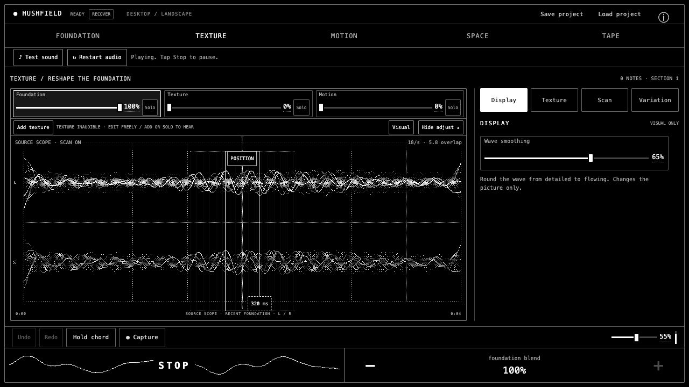

## Start/Stop output Scope — 2026-10-25

The Start/Stop button now contains a compact stereo Scope using the existing passive post-master capture and Scope renderer. It uses the shared frame budget and no additional audio nodes. Its canvas ignores pointer events and is hidden from accessibility; Start/Stop retains its accessible name and centered label. Holding the editor picture snapshots its data so the transport can keep reading the shared capture. Reduced motion removes the output trails.

The build, all 69 Node results and whitespace checks passed. Browser checks covered desktop and 390×844 layouts, Start/Stop by mouse and Space, navigation, output activity while Hold picture is selected, and zero main-output signal after muting Master volume. No console warnings/errors were observed. The phone Scope fit within the 195×79 button without horizontal overflow. Physical-device performance remains unverified.

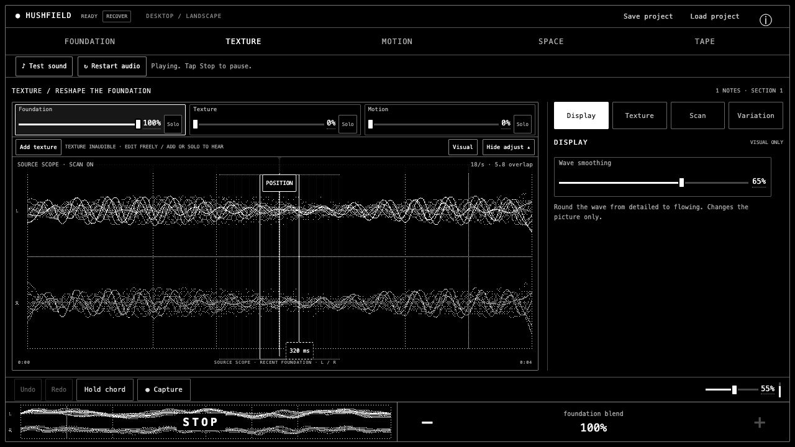

## Adjustment panel default — 2026-10-25

Texture's adjustment dock now opens by default. The build and whitespace check passed; a fresh browser reload showed the expanded panel and Wave smoothing control. Hiding and reopening the dock still worked.

## Texture source Scope — 2026-10-25

Texture now uses the actual Visual Scope renderer with stacked stereo traces, the Scope grid, gain and fading trails. The full source remains on the horizontal axis, with grain handles aligned to the plot margins. Live-source telemetry includes both channels; mono material is displayed in both lanes. Wave smoothing and the hidden adjustment dock remain available. Trim keeps its source-editing display.

The build and all 69 Node results passed. The live-source test checks both telemetry channel lengths and preservation of opposite-phase stereo. Browser checks compared Texture against Visual Scope during playback, exercised read-anchor editing and Undo, and changed Wave smoothing with Undo. Desktop and 390×844 phone views were inspected; the phone dock remained below the 372×272 visual with no horizontal overflow. This is a candidate for user assessment.

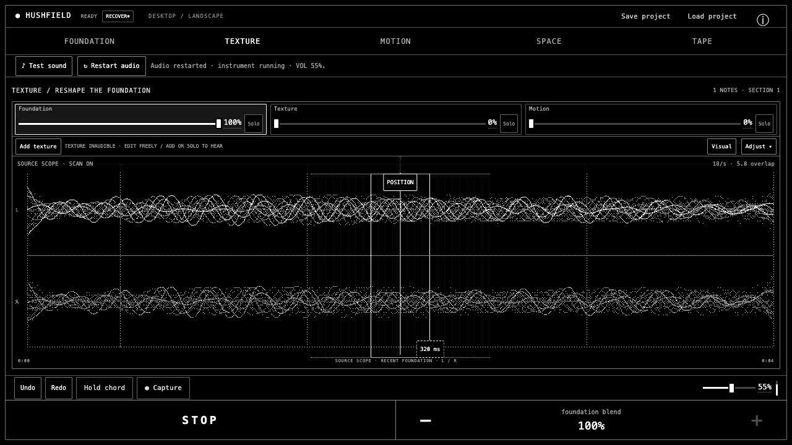

## Smooth waveform and adjustment dock — 2026-10-25

Texture now starts with its inspector hidden. Adjust opens a dock beside the visual on wide screens and below it on phones. The Display tab contains Wave smoothing (0–100%, default 65%). The display filter preserves signed input, leaves source samples unchanged, and uses bounded cubic interpolation. The setting participates in Visual project/recovery state and settings history.

The final build, 69 Node results and whitespace checks passed. New checks cover attenuation of sharp alternation, signed low-frequency content, DC preservation, finite/bounded empty/short inputs, defaults and project restoration. Browser checks covered 1280×720, 1024×768, 650×900, 390×844, 320×568 and 844×390; visible artwork, open/closed dock, readout/slider, Undo, Escape focus return, Texture/Scan/Variation access and editor navigation were checked. Measured dock/stage bounds did not overlap in phone, tablet or split view, and checked outer bounds matched the viewport. Short landscape initially collapsed the stage; this was corrected and rechecked. No console warning/error was observed. Physical-device acceptance remains with the user.

## Texture artwork follow-up — 2026-10-25

After visual feedback, Texture uses sparse dithered patches and broken contours around a clear source-wave lane. A small number of black-centered, outlined grain windows remain distinct from the bright waveform and softer background. Scatter hatching is lighter and the selected window is unfilled. The bounded renderer uses source amplitude and Texture settings; it reuses the existing frame budget and pauses its drift with playback/reduced motion. Trim keeps its existing waveform display. Fresh asset versions also resolve empty cached visual-control styles in the Tailscale browser session.

The full Node suite passed 66 results. Fresh browser checks on the private HTTPS preview covered desktop and 390×844 Texture rendering, live playback, grain-length and read-anchor edits, and visible editing handles over the artwork. The lighter follow-up was rechecked on desktop and 390×844 with live audio and read-anchor editing. A subsequent waveform refinement replaces Texture peak bars with Visual Scope's shared signed-line renderer; both views were inspected during playback, along with Texture's phone layout and read-anchor editing. The checked session had no console warnings/errors. This is a visual candidate for user assessment.

## Visual-control branch checks — 2026-10-25

Candidate branch `codex/visual-editor-controls`, based on `6e5c607`, implements direct controls in the real app. The final build and full Node suite passed **66 test results**; `git diff --check` passed. The original main checkout stayed clean.

Fresh in-app-browser checks exercised direct category selection before playback, exact grain length entry, Texture editing at zero blend, read-anchor dragging and Undo, trim In dragging, two-axis filter dragging, Tape bypass/sections, trigger selection without audition, envelope dragging, Mixed All targets, spectrum inspection, and keyboard Undo from a focused range. No console warnings/errors were observed in the checked app session. The browser also passed 5 offline Piece and 10 offline Tape checks, including finite stereo output and 44.1/48 kHz bypass/coloration.

Desktop, 390×844, 320×568, 844×390 and 1024×768 layouts were inspected. Long inspectors scroll internally; the 320×568 and 390×844 outer document dimensions matched their viewport. Very short Tape displays prioritize the editable echo grid over the cassette. These checks are targeted browser observations, not a new exhaustive viewport matrix or physical-device acceptance.

Try: Start → Texture → Add texture → drag POSITION and the millisecond handle → Undo. Then shape the Space filter, try Tape Echo/Character, and select a Motion trigger → Envelope → drag A/S/R → Listen. Underlined values open exact entry. The [playing guide](PLAYING.md) explains editing and history boundaries.

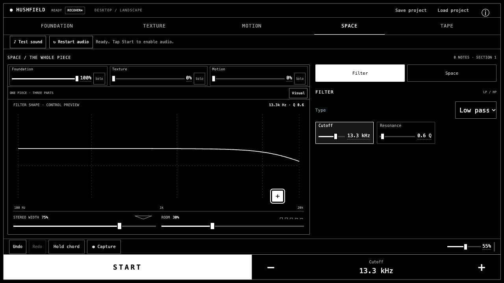
